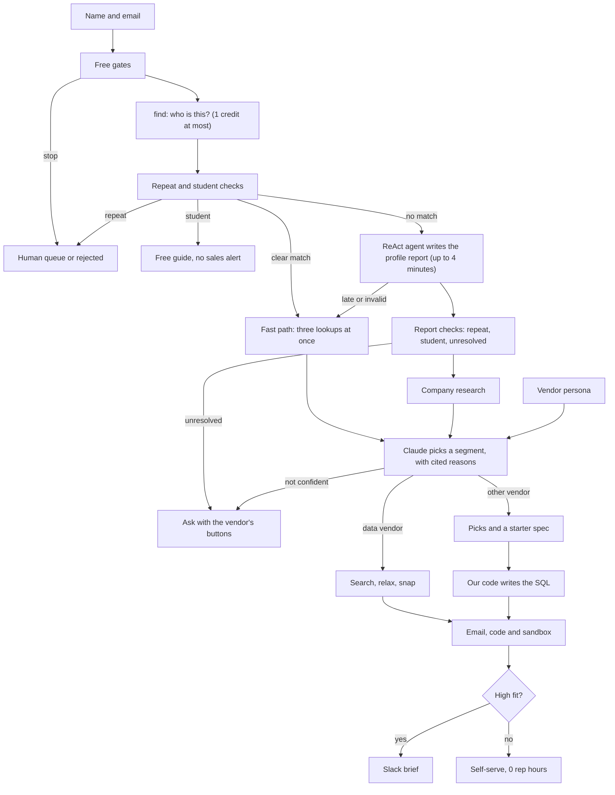

# CrustFlow

A service that answers every signup to a company with a personal, researched email, the kind a good solutions engineer would write.

A person signs up with a name and email. CrustFlow researches them, reads what the company offers, and has Claude write an email saying which parts of the product fit their work, and why. Every claim cites its source. High-fit accounts go to sales. Repeats and competitors never reach a person.

Crustdata is the data behind the research. The demo mimics Supabase, which isn't involved: every email says so.

Built at ContextCon 04 (Crustdata x Y Combinator), theme "Services, Replaced", closest to Revenue: "Answer and route every inbound lead within a minute, without inventing a claim."

**Demo video:** to be added. **Diagram:** below.

## The service

Solutions engineers build a custom proof of concept for each promising account. Vendors pay for that: about $123k-$138k base in the US, with one engineer covering about four account executives (sources in [docs/research.md](docs/research.md)). So it only happens for the biggest deals.

Everyone else signs up, gets a key and the docs, doesn't know what to try first, and leaves. CrustFlow does that first job for every signup, for about 3 to 13 credits each.

## What it does today

No one steps in between the signup and the finished work:

1. **Screens the signup** for free: malformed, disposable, repeat inbox, internal and competitor addresses.
2. **Finds the person** with a cheap name match at their email's company, so repeats and clear students stop here.
3. **Researches them:** a clear match takes the fast path, with three lookups at once. Anyone the name match can't place gets a ReAct agent, which writes a cited profile report that becomes the evidence for everything after it. If it's late or wrong, a basic builder takes over.
4. **Decides** with Claude, using the vendor's persona and that evidence. Claude picks a segment from the vendor's fixed list and writes a short opening. Each claim must cite evidence from a real response, or it's dropped.
5. **Does the work:** for Supabase, a starter: SQL named after their company, written by our code from Claude's spec. For Crustdata, a search built from fixed templates, with every value checked against autocomplete. It widens the search if results are thin, and says so in the email.
6. **Delivers** the work, the code that produced it, and a sandbox where one click runs it. The Supabase sandbox is real Postgres with pgvector in their browser, with no login.
7. **Routes** high-fit accounts to sales with a credit estimate whose assumptions are printed.
8. **Stays useful:** founders and CEOs of startups get a Crustdata watch on their profile and company. A strong change, such as a funding round, leads to one cited email at most, with a stop link. Real watches stay planned until `WATCH_LIVE=true`, because each change costs 5 credits.

It asks the signup only when the answer would change the result, and it goes to a person only for exceptions: repeats, disposable domains and competitors.

### On real data
Measured on 6 Nov 2026 against the live Crustdata API and Claude, with sending turned off.

| Signup | Claude decided | First result | Credits | Time |
|---|---|---|---|---|
| Head of Talent at an AI infrastructure startup | Recruiting, 0.90 | 10 engineers for a role they have open | 5.58 | 9.6 s |
| An ATS vendor, role address only | GTM, 0.85 | 10 Heads of Talent Acquisition | 4.45 | 8.1 s |
| Founder of a supply-chain finance company | GTM, 0.60 | 10 CFOs at manufacturers | 5.46 | 7.6 s |
| Staff engineer at a vector database startup, with a profile report | Builder, 0.85 on 9 of 9 runs | 10 real companies to try the API on | 12.85 | 8-11 s, plus about 3 minutes for the report |
| Automation software company, role address only | Unknown, 0.30 | Asked with buttons | 2.15 | 6.3 s |

The same signup gets a different result per company. Run as Supabase, no search runs, and they get the services that fit their work, plus a starter they can run:

| Signup, run as Supabase | Claude decided | First result | Credits | Time |
|---|---|---|---|---|
| Engineer at a transcription startup | AI builders, 0.60 | Vector, Auth and Storage, with a transcript table and match function | 3.13 | 15.9 s |
| Staff engineer at a vector database startup | AI builders, 0.70 | Not pitched pgvector: Database, Auth and MCP, with a table for the systems around their product | 3.13 | 16.1 s |
| CTO at a mid-size data company | Larger companies, 0.80 | Compliance, Database and Auth, plus a sales brief with an opening angle and a dated hiring signal | 3.28 | 15.5 s |
| Student researcher the name match missed | Solo builders, 0.80 | Went to the agent, then a starter | 9.87 | 81 s |

Every starter above ran in Chrome: table, policy, sample rows, query and each button.

## Run it in one minute

No keys needed. Simulator mode runs the whole product against an invented population.

```bash
uv sync
uv run uvicorn app.main:app --port 8000
```

Open http://localhost:8000 and press **Run 3 signups**, or use the form:

| Name | Email | What happens |
|---|---|---|
| Priya Sharma | `priya@hirefast.in` | High fit: 10 people, code, sandbox and a sales brief |
| Priya Sharma | `priya.sharma.dev@gmail.com` (after the one above) | Same person, second email: held for a human |
| Alex Mercer | `alex@northwindai.io` | Founder: buyers in their market |
| Meera Joshi | `meera.ops@gmail.com` | Personal email: finds their employer from a unique name |
| Rohan Kulkarni | `rohan.codes@gmail.com` | Student: free-endpoint guide, no sales alert |
| | `prof.rao@iitk.ac.in` | Faculty: papers in their field, never treated as a student |
| Asha Menon | `someone@gmail.com` | Two people share the name, so it asks |
| | `jane@crustdata.com`, `sam@zoominfo.com`, `x@mailinator.com`, `not-an-email` | Internal, competitor, disposable and malformed gates |

Pick **Supabase** in the dropdown to see the personal email. **Failure drills** in the top right force a 429, a 500, a Claude outage or a failed send, so you can watch each one recover in the call log.

## How it's built



| Part | What it uses |
|---|---|
| Model | Claude (`claude-opus-5-5`) for one structured decision, with a rules fallback if it fails |
| Sandbox | PGlite 0.2.17: real Postgres with pgvector, in the signup's browser. Nothing generated runs on our server |
| Data | Crustdata: `/company/identify`, `/company/enrich`, `/person/search`, `/person/enrich`, `/job/search`, autocomplete, `/web/search/live` |
| State | SQLite: signups, every call with its credits, identity claims and a response cache |
| Runs on | FastAPI, one long-running process with one worker, because the rate limiter and live event stream live in memory |
| Delivery | Resend and a Slack webhook, always mirrored in the dashboard, with a recipient allowlist |

**Design choices:**

- **Claude can't invent a source.** It can only cite IDs from an evidence table built from real responses, and citations are rendered from that table. A reason or opening with an unknown ID is dropped.
- **Claude never writes a query.** It returns a segment from a fixed list and short values that are snapped to canonical ones, so an instruction hidden in someone's headline can't change a search.
- **Spend is capped before each call.** Budgets start at 1 credit and rise to 8 only once someone is worth serving. If a retry would pass the cap, the limit shrinks to fit.
- **The emailed code reproduces the emailed rows.** Results are never merged across retries.
- **A company is a file.** Copy `app/personas/supabase.json` to add one: its services, who signs up and what to look for. Segments with a Crustdata playbook run a search, and the rest get the personal email.
- **The report is the contract.** The profile agent writes a `user-profile/v1` report (`app/pipeline/profile_doc.py`), which a person can read and check. Set `PROFILE_BUILDER=react` to use it, and any failure falls back to the basic builder. `scripts/try_report.py <file>` runs a report through the real pipeline with sending off.
- **Claude proposes a table, our code writes the SQL.** Names are checked, values are typed and quoted, and text from a public profile can't become a statement. A spec we can't make safe drops the code, and the email still goes.
- **The code they read is the code they see run.** The sandbox runs the emailed SQL unchanged, and says plainly what it is: Postgres in the browser, not a Supabase project.
- **The email is a blueprint.** Each service sits on the lines of SQL it adds, so the reasons and the code are one thing.
- **Claude picks, the company supplies.** Services and links come from the company's file, so Claude can't invent a feature or a URL. A pick without real evidence is dropped.
- **We check identity ourselves.** The agent can settle on a namesake, so we compare what it found with the email's domain and our own search before trusting it.
- **Research isn't quoted back at people.** Claude never sees ruled-out namesakes or identity proof, GitHub trails stay out of emails, and contact details are masked.

## Approaches we tried

| Approach | Result |
|---|---|
| Look the email up with `/person/identify` | Designed around this, but Crustdata declined to enable it on our key, and no other endpoint accepts an email |
| Web-search the email address | Rejected: it reads as invasive, and web search timed out at 25 s when we tried a name |
| Ask for a profile link | Dropped: an extra step at signup, and it only helps personal emails |
| Ask for a name, then search for the full phrase | Failed on real data: the name in an address often differs from the profile, such as a middle name used as a surname |
| **Search each part of the name, accept only one unique match** | **Chosen.** It cost 0.13 credits on the case that failed, and a tie asks rather than guesses |
| Find 5 companies, then buyers there | Failed on real data: five companies rarely have the exact title, so results fell back to unrelated executives |
| **Search the buyer's title across the market** | **Chosen.** Cheaper, and the people match what the opening says |
| One vendor, hard-coded | Replaced with personas, so Claude decides what to look for from a description of the vendor |
| The loop fills Python objects in two steps | Dropped once we saw its real output: a cited report holds more, and identity proof and caveats had nowhere to go |
| **The loop's report is the profile, after a cheap check** | **Chosen.** Repeats and students stop for about 0.13 credits, not 7.42 |
| The agent researches everyone | Replaced: 92-185 s per signup for the email's first lines. A name match was already enough for most people |
| **A clear match skips the agent** | **Chosen.** About 15 s and 3.2 credits. The agent stays for the people the name match can't place |
| Fetch the company's homepage on the fast path | Cut: it took over 6 s on real signups, and the emails were specific without it |
| Claude writes the SQL | Rejected: free-form SQL could fail in front of the signup, and text from a profile could reach it |
| **Claude fills a spec, our code writes the SQL** | **Chosen.** Every starter so far ran first time |
| A server-side sandbox, or real Supabase projects | Rejected: running generated SQL on our server is a risk, and we can't create projects for a company we're imitating |
| **Real Postgres in the browser** | **Chosen.** No server, no login, and no key |
| Fit engineers into the existing segments | Failed: a full profile still stalled at 55%, because selling and recruiting don't describe them |
| **A builder segment** | **Chosen.** 85% on 9 of 9 runs |

The full record is in [docs/build-log.md](docs/build-log.md).

**The hardest case** is telling who someone is without an email lookup. A wrong match would send confident claims about a stranger. So a partial match needs to be the only person at the company who fits, every citation says how the person was matched, and Claude is told not to mention job details on a weak match.

**How we tested it:**
- Unit and end-to-end tests run against a simulator that evaluates real filters, charges measured credits and rejects what the real API rejected.
- The test matrix runs 21 signups, including messy input.
- Real signups ran through the live API and Claude, and we read every email. That caught what tests couldn't: reasons cut off mid-sentence, an opening claiming setup that never happened, results described as more specific than the search was, and an ATS vendor's customer jobs read as its own.

**What we left out:** resuming after a crash, a person's approve button on the human queue, and multi-tenant accounts.

**What comes next:**
1. Resume a run after a crash, and guarantee an email is never sent twice.
2. Measure which first results lead to a second call, and feed that back into each vendor's persona.
3. Turn on live watches once a public webhook URL exists, and extend them to hiring signals.

**Where this is heading:** today's agent does the first proof of concept. Once it can see what each customer does next, it can keep doing that job through the whole account, and a person steps in only for the deals that need one.

## Going live

```bash
cp .env.example .env    # Then fill it in
uv run python scripts/probe_api.py --yes
```

The probe checks our assumptions against the real API and prints the table for `docs/crustdata-api.md`. It spends about 4 credits. `GET /account/endpoints` is free and lists what your key can call.

| Setting | Purpose |
|---|---|
| `CRUSTDATA_MODE` | `sim`, `live`, `record` or `replay` |
| `CRUSTDATA_API_KEY` | Your Crustdata key |
| `VENDOR_PERSONA` | The company to run as: a file in `app/personas/` |
| `PROFILE_BUILDER` | `basic`, or `react` to run the profile agent |
| `FAST_PATH` | `true` by default: a clear name match skips the agent |
| `WATCH_FOUNDERS` | `true` by default: founders and CEOs of startups get a watch |
| `WATCH_LIVE` | `false` by default: real watches are only planned, because each change costs 5 credits |
| `WATCH_POLL_S` | Seconds between reading watch runs. `0` leaves it to the dashboard's button |
| `ANTHROPIC_API_KEY`, `LLM_MODEL` | Claude. Without a key, the rules classifier runs |
| `ANTHROPIC_WORKSPACE_ID` | Only for a key that isn't scoped to a workspace |
| `EMAIL_LIVE`, `EMAIL_API_KEY`, `EMAIL_FROM`, `EMAIL_ALLOWLIST` | Resend. Real sends go only to allowlisted addresses |
| `EMAIL_REDIRECT_TO` | Test on real profiles: every email goes to this address instead, which must be on the allowlist |
| `SLACK_LIVE`, `SLACK_WEBHOOK_URL` | Sales cards |
| `APP_BASE_URL` | The public URL used in sandbox links |
| `DEMO_PASSWORD` | Basic auth for the dashboard (user `demo`). Set this on any public host, because signups spend credits |
| `DEMO_SIGNUPS`, `MATRIX_SIGNUPS` | Comma-separated `email\|Full Name` entries for the dashboard's demo buttons |

Nothing leaves the app until `EMAIL_LIVE` or `SLACK_LIVE` is on, and simulated data never does.

### Deploy

Run one always-on container with a volume at `/data`:

```bash
docker build -t crustflow .
docker run -p 8000:8000 --env-file .env -v crustflow:/data crustflow
```

Avoid serverless hosts, because the limiter and event stream need a long-lived process.

### Record a replay

For a demo that survives bad Wi-Fi:

1. Run the demo once with `CRUSTDATA_MODE=record`, including the pill clicks.
2. Restart with `CRUSTDATA_MODE=replay`. Everything then comes from `cache/replay/`, with no network, and the dashboard shows a banner.

Recordings hold real profile data and are gitignored.

## Tests

```bash
uv run pytest
uv run python scripts/run_matrix.py --reset    # Against a running server
```
