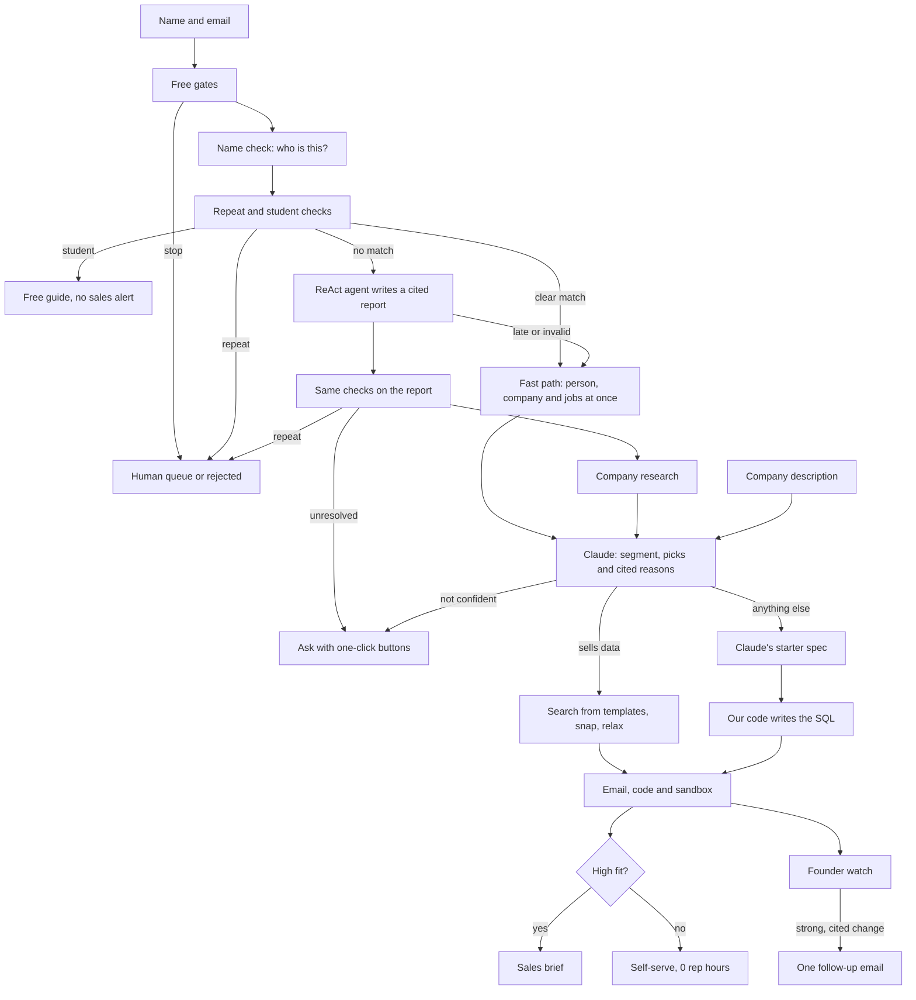

# CrustFlow

A service that answers every signup to a company with a personal, researched email and a first working result, the kind of thing a good solutions engineer would build.

Someone signs up with a name and an email. In about 12 seconds, CrustFlow works out who they are, reads what the company offers, and sends them an email saying which parts of the product fit their work, with code named after their company that runs in their browser with no login. Every claim cites a source. High-fit accounts go to sales. Repeats, competitors and throwaway addresses are held for review instead of being served.

Crustdata is the data behind the research. The demo imitates Supabase, which isn't involved, and every email and sandbox says so.

Built at ContextCon 04, IIT Kanpur (Crustdata x Y Combinator), theme "Services, Replaced". Closest listed service: Revenue, "Answer and route every inbound lead within a minute, without inventing a claim."

**Demo video:** to be added. **Diagram:** [How it's built](#how-its-built).

## The service

**The job it takes on:** the solutions engineer's first proof of concept. That means looking at one new account, working out what they're trying to do, and building them a first working example.

**Who does it today:** solutions engineers, by hand, one account at a time. So it only happens for the biggest deals. Everyone else signs up, gets a key and the docs, doesn't know what to try first, and leaves.

**Who pays:** the company selling the product. A solutions engineer costs about $123k to $138k base in the US, and one covers about four account executives (sources in [docs/research.md](docs/research.md)). CrustFlow does that first job for every signup, for about 3 to 13 Crustdata credits each.

## What it does now

From a name and an email to finished work, with nobody stepping in:

1. **Screens the signup** for free: malformed, disposable, repeat inbox, internal and competitor addresses.
2. **Finds the person** with a cheap name match at their email's company. Repeats and clear students stop here.
3. **Researches them.** A clear match takes the fast path, with three lookups at once. Anyone the name match can't place gets a ReAct agent, which writes a cited profile report. If it's late or wrong, a basic builder takes over and the signup is flagged.
4. **Decides** with Claude, using the company's description and that evidence. Claude picks a segment from a fixed list, the services that fit, and a short opening. A claim that doesn't cite real evidence is dropped.
5. **Does the work.** For Supabase, Claude proposes a table and our code writes the SQL. For Crustdata, it runs a real first search from fixed templates, with every value checked against autocomplete.
6. **Delivers it.** The email is a blueprint: each service sits on the lines of SQL it adds. One click runs that SQL in real Postgres in their browser, and a second run marks them Activated.
7. **Routes** high-fit accounts to sales with a cited brief, an opening angle and a dated signal.
8. **Stays useful.** Founders and CEOs of startups get a Crustdata watch on their profile and company. A strong change, such as a funding round, leads to one cited email at most, with a stop link. On real data these watches stay planned until `WATCH_LIVE=true`, because each change costs 5 credits.

### Where it still needs a person

- **Exceptions:** repeat identities, disposable domains and competitors go to a human queue. There's no approve button yet, so a person acts on them outside the app.
- **Sales:** high-fit accounts go to a rep, who has the conversation. CrustFlow writes the brief and doesn't close anything.
- **The company's description:** a person writes the file saying what the company offers and who signs up.

When it's unsure about a signup, it doesn't guess or call a person. Below 0.6 confidence it asks the signup with one-click buttons.

### On real data

Measured on 6 Nov 2026 with the live Crustdata API and Claude, with emails redirected to our own test inbox.

| Signup, run as Supabase | Claude decided | What they got | Credits | Time |
|---|---|---|---|---|
| Engineer at a transcription startup | AI builders, 0.60 | Vector, Storage and Queues, on a transcript table with a search function | 3.13 | 12.2 s |
| Staff engineer at a vector database startup | AI builders, 0.72 | Not pitched pgvector: Database, Auth and MCP, on a table for the systems around their product | 3.13 | 12.9 s |
| CTO at a mid-size data company | Larger companies, 0.80 | Compliance, Database and Branching, plus a sales brief | 3.28 | 12.7 s |
| Founder of a startup, company already cached | AI builders, 0.75 | A starter, with founder watches planned | 1.13 | 11.5 s |
| Student the name match missed | Solo builders, 0.80 | Went to the agent, then a starter | 9.87 | 81 s |
| Someone even the agent couldn't identify | No guess | Asked with buttons, and flagged | 10.16 | About 45 s |
| Same person, second address | Repeat | Held for a person | 0.13 | Seconds |
| Malformed, disposable or the vendor's own staff | Stopped by the gates | Rejected, held or an internal reply | 0 | Instant |

Every starter we generated ran in Chrome: table, policy, sample rows, query and each button.

The same signup gets a different result per company. Run as Crustdata, a Head of Talent at an AI infrastructure startup got 10 engineers for a role they have open, with the code and a sandbox, for 5.58 credits in 9.6 s.

### What this hasn't proved

- **The starter on a real Supabase project.** We ran the SQL in PGlite, not on Supabase, so the `pgmq` and `pg_cron` lines in particular are untested.
- **Live Slack posts and live founder watches.** There's no webhook set, so sales cards show in the dashboard, and real watches stay planned until `WATCH_LIVE=true`. Founder emails have only run on simulated data.
- **Scale.** The agent has run on a handful of people, and Claude's confidence moves between runs near the 0.6 bar. One signup got a full email on one run and the ask email on the next.
- **Outlook.** We read emails in Chrome and sent them through Resend to one test inbox, so no other mail client has been checked.
- **A public URL.** It runs on a laptop. Sandbox links only work where `APP_BASE_URL` can be reached.

The Docker image has never been built, because Docker wasn't on the build machine.

## What it could do in the future

| Next | Why it isn't built now |
|---|---|
| Create a real project for the signup, so the starter runs in their account | It needs the vendor's own API access. We're imitating Supabase, so we can't, and shouldn't, act on their platform |
| Learn which first results lead to a second run, and feed that into each company's description | It needs real signups over days. A one-night demo has no such data |
| Resume a signup after a crash, and guarantee an email is never sent twice | Founder events already do this. The main path needs saved steps too, and a run takes seconds, so we put the night into the first result instead |
| Turn on live founder watches, then extend them to hiring signals | Each change costs 5 credits and commits an account to recurring spend, and webhooks need a public URL we don't have |
| Give the agent a credit cap again | The faster agent dropped the old cap, and its runs have cost about 7 to 10 credits. It now counts spend from `X-Credits-Used`, so a real cap is a small change, but we found this in the last hours and chose not to change the agent again before the deadline |
| Add an approve button to the human queue, and accounts for many companies | One company at a time is enough to prove the service. Accounts add login and billing, and no signal about the work |

## The future of this service

Today the agent does the first proof of concept and then stops. That's the part of the job that's cheapest to automate and most often skipped.

Once agents can do the whole job, the work doesn't end at the first result. An agent that can see what each customer does next can keep going: notice when they get stuck, write the next integration, answer the security review, and prepare the renewal. The founder watch is an early step, because it acts on what changes in the customer's world without being asked.

Solutions engineering then shifts. Every account gets the attention that only the biggest get today, and people step in for the deals that need trust and judgement. For a company with thousands of signups, the proof of concept stops being something it can only afford for a few.

## How to run it

You need [uv](https://docs.astral.sh/uv/). No keys are needed: simulator mode runs the whole product against an invented population, and nothing leaves the app.

```bash
uv sync
uv run uvicorn app.main:app --port 8000
```

Open http://localhost:8000 and press **Run 3 signups**, or use the form:

| Name | Email | What happens |
|---|---|---|
| Priya Sharma | `priya@hirefast.in` | High fit: 10 people, code, sandbox and a sales brief |
| Priya Sharma | `priya.sharma.dev@gmail.com` (after the one above) | Same person, second email: held for a person |
| Rohan Kulkarni | `rohan.codes@gmail.com` | Student: free-endpoint guide, no sales alert |
| | `prof.rao@iitk.ac.in` | Faculty: papers in their field, never treated as a student |
| Asha Menon | `someone@gmail.com` | Two people share the name, so it asks |
| | `jane@crustdata.com`, `sam@zoominfo.com`, `x@mailinator.com`, `not-an-email` | Internal, competitor, disposable and malformed gates |

**Failure drills** in the top right force a 429, a 500, a Claude outage or a failed send, so you can watch each one recover in the call log.

### See the Supabase email and a starter

Claude writes this email, so it needs a Claude key. Without one, a Supabase signup gets the ask email.

```bash
ANTHROPIC_API_KEY=your-key uv run uvicorn app.main:app --port 8000
```

Pick **Supabase** in the dropdown and sign up `Alex Mercer`, `alex@northwindai.io`. Read the email in the dashboard, open the **Sandbox** tab, then press a button and watch the status flip to Activated. The sandbox loads Postgres from a CDN, so it needs internet. Alex is a founder, so the **Watch** tab also shows their watches, and lets you simulate a change such as a funding round.

### Run it on real data

```bash
cp .env.example .env    # Then fill it in
PROFILE_BUILDER=react VENDOR_PERSONA=supabase EMAIL_REDIRECT_TO=you@example.com \
  uv run uvicorn app.main:app --port 8000
```

`EMAIL_REDIRECT_TO` sends every email to one inbox, which must be on `EMAIL_ALLOWLIST`. Use it to test on real profiles without emailing real people. Every setting is explained in [.env.example](.env.example). Check a key against our assumptions with `uv run python scripts/probe_api.py --yes`, which spends about 4 credits.

### Test it

```bash
uv run pytest                                          # 442 tests
uv run python scripts/run_matrix.py --reset            # 21 signups, against a running server on the simulator
```

## How it's built



| Part | What it is |
|---|---|
| **Agents** | One decision call per signup, plus the ReAct profile agent for people the name check can't place. Code runs its Crustdata calls, a lighter model does one round of web research, and a stronger model writes the report |
| **Models** | Claude Opus 5.5 (`claude-opus-5-5`) for the decision and for writing the report, Claude Sonnet 5.5 for the agent's research. A rules fallback takes over if Claude fails |
| **Tools** | The Claude Agent SDK and the Crustdata MCP server in the agent, public web search and fetch, and public GitHub and Gravatar lookups to prove identity, which never reach an email |
| **Data** | Crustdata, every company's description in `app/personas/`, and the public web |
| **State** | SQLite in WAL mode: signups, every call with its credits, identity claims, a response cache, pill runs, watches and watch events. Reports are also saved in `profile_agent/output/`. The rate limiter and live event stream are in memory |
| **Runs on** | FastAPI, Jinja, vanilla JS and server-sent events, as one long-running process with one worker. Starters run in the signup's browser on PGlite, so nothing generated runs on our server. Resend sends email, and a Slack webhook takes sales cards |

**Where it calls Crustdata:**

| Step | Endpoints |
|---|---|
| Name check | `/company/identify`, `/person/search` |
| Fast path | `/person/enrich`, `/company/enrich`, `/job/search` |
| First search | `/person/search`, `/company/search`, autocomplete, `/web/search/live` |
| Profile agent | The above, plus `/social_post/search`, `/web/search/live`, `/web/enrich/live` and the MCP server |
| Founder watch | `/watch/person`, `/watch/company`, and each watch's runs |

**Design choices:**

- **Claude can't invent a source.** It can only cite IDs from an evidence table built from real responses, and citations are rendered from that table.
- **Claude never writes a query or SQL.** It fills in fixed shapes, and our code writes the rest. Names are checked, values are typed and quoted, and an instruction hidden in someone's profile can't become a statement. A spec we can't make safe drops the code, and the email still goes.
- **The code they read is the code they see run.** The sandbox runs the emailed SQL unchanged, and says plainly that it's Postgres in the browser, not a Supabase project.
- **Spend is capped before each call.** Budgets start at 1 credit and rise to 15 only once someone is worth serving. The agent is the exception: it has no cap of its own, and its spend is counted against the signup afterwards.
- **A company is a file.** Copy `app/personas/supabase.json` to add one. Services and links come from that file, so Claude can't invent a feature or a URL.
- **We check identity ourselves.** The agent can settle on a namesake, so we compare what it found with the email's domain and our own search.
- **Research isn't quoted back at people.** Claude never sees ruled-out namesakes, identity proof, GitHub trails or people's own posts, and contact details are masked.

## The approaches we tried

| Approach | What happened |
|---|---|
| Look the email up with `/person/identify` | **Didn't work.** We designed around it, but Crustdata declined to enable it on our key, and no other endpoint accepts an email |
| Web-search the email address | **Rejected.** It reads as invasive, and web search timed out at 25 s when we tried a name |
| Ask for a name, then search the full phrase | **Failed on real data.** The name in an address often differs from the profile |
| Search each part of the name, and accept only one unique match | **Worked.** It cost 0.13 credits on the case that failed, and a tie asks instead of guessing |
| Find 5 companies, then buyers there | **Failed on real data.** Five companies rarely have the exact title, so results fell back to unrelated executives |
| Search the buyer's title across the market | **Worked.** Cheaper, and the people match what the opening says |
| One vendor, hard-coded | **Replaced** with a file per company, so Claude decides what to look for from a description |
| The agent fills Python objects | **Dropped** once we saw its real output. A cited report holds more, and a person can read it |
| The agent researches everyone | **Too slow.** 92 to 185 s per signup, when a name match had usually found them already |
| A clear match skips the agent | **Worked.** About 12 s and 3.2 credits, down from 92 to 185 s |
| One agent does every step | **Replaced.** Code now runs the Crustdata calls and the model writes once, so a real run took 81 s where the same person had taken 130 to 224 s |
| Fetch the company's homepage on the fast path | **Cut.** It hit its 6 s limit on real signups, and the emails were specific without it |
| Claude writes the SQL | **Rejected.** It could fail in front of the signup, and text from a profile could reach a statement |
| Claude fills a spec, and our code writes the SQL | **Worked.** Every starter so far has run first time |
| A sandbox on our server, or real Supabase projects | **Rejected.** Running generated SQL on our server is a risk, and we can't create projects for a company we're imitating |
| Real Postgres in the browser | **Worked.** No server, no login and no key |
| Print "saved 45 minutes" and "time to Hello World: 0 s" | **Refused.** We have no measurement behind them. The sandbox shows the real time it took |
| Four email designs, built as working emails | **We chose the blueprint,** where each service sits on the lines it adds, over a pull request, a plain note and a results-first layout |

**The hardest case** is telling who someone is without an email lookup. A wrong match sends confident claims about a stranger. So a partial match must be the only person at the company who fits, every email says how the person was matched, and on a partial match it doesn't state their title, employer or history.

**How we tested it:** unit and end-to-end tests run against a simulator that evaluates real filters and rejects what the real API rejected. The test matrix runs 21 signups, including messy input. Then real signups ran through the live API and Claude, and we read every email and opened the sandboxes in Chrome. That caught what tests couldn't: reasons cut off mid-sentence, an opening claiming setup that never happened, a vector database engineer being sold pgvector, and a merge that broke the agent while every test still passed.

The full record, including what failed and why, is in [docs/build-log.md](docs/build-log.md).

---

This repo is a fresh copy of our working repo, `crustdata_v1`, made on 6 Nov 2026 at about 6 AM. That repo has the full commit history, starting at 9:59 PM on 5 Nov.
